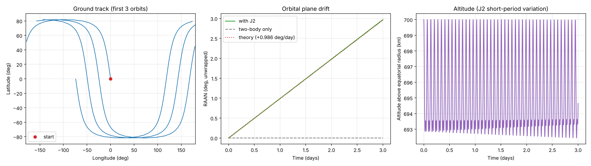
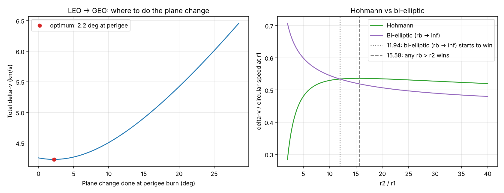
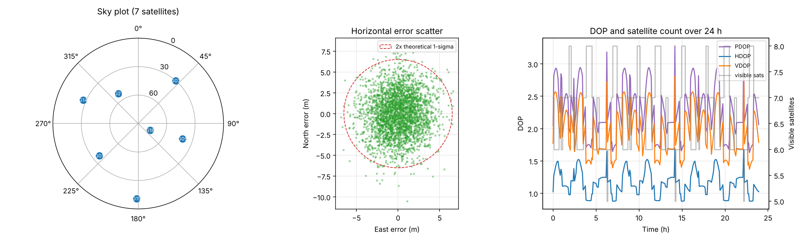

# Space & Navigation Projects (Python)

Three small, validated Python projects in orbital mechanics, mission design and satellite navigation.
Each script runs standalone, prints a validation against theory, and saves a figure to its `output/` folder.

```bash
pip install -r requirements.txt
python orbit-propagator/orbit_propagator.py
python mission-planner/mission_planner.py
python gnss-positioning/gnss_positioning.py
```

## 1. Orbit Propagator with J2 (`orbit-propagator/`)
RK4 integration of a satellite orbit (two-body + Earth oblateness J2), ground track, and a sun-synchronous orbit designer.

| Check | Result |
|---|---|
| Two-body energy conservation over 3 days | relative drift 1e-9 |
| Sun-synchronous orbit at 700 km | inclination 98.19 deg |
| Orbital-plane (RAAN) drift, simulated vs theory | +0.990 vs +0.986 deg/day (0.4 % apart) |



## 2. Mission Delta-V Planner (`mission-planner/`)
Hohmann and bi-elliptic transfers, LEO to GEO with optimal plane-change split, Earth to Mars transfer, rocket-equation propellant budgets.

| Result | Value |
|---|---|
| LEO (300 km) to GEO, coplanar Hohmann | 3.89 km/s, 5.28 h |
| Same from 28.5 deg latitude, plane change split optimally | 4.23 km/s (2.2 deg at perigee, 26.3 deg at apogee) |
| Plane change as a separate GEO burn instead | 5.41 km/s (1.18 km/s worse) |
| Trans-Mars injection from LEO | 3.59 km/s, 259 days, Mars leads by 44.3 deg |
| Bi-elliptic starts to beat Hohmann | r2/r1 about 12 (theory 11.94) |



## 3. GNSS Positioning Solver (`gnss-positioning/`)
A 24-satellite GPS-like constellation, pseudorange simulation, weighted least-squares position and clock solution, DOP analysis.

| Check | Result |
|---|---|
| Noise-free solve | exact (0.0000 mm error) |
| Monte-Carlo 3-D RMS error vs theoretical covariance | 6.33 m vs 6.31 m (0.3 % apart) |
| 24 h satellite visibility (10 deg mask) | 5 to 8 satellites, median PDOP 2.25 |



## Notes
- Ground track uses a spherical Earth and a simplified Earth-rotation angle (no precession or nutation).
- The GNSS constellation is a Walker 24/6/1 model, not the real GPS almanac, and noise is Gaussian (no ionosphere, troposphere or multipath).
- Possible next steps: add drag and lunar/solar perturbations, read real TLE files with `sgp4`, add an Extended Kalman Filter to the GNSS solver.
